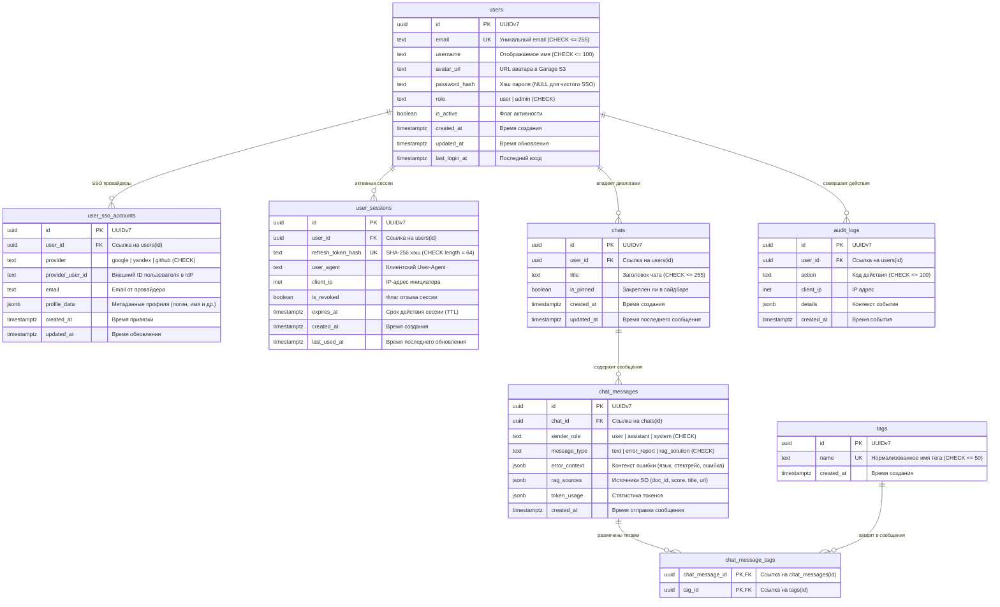

# 03-data.md — Хранение данных, форматы индексов и графа знаний

## 1. Структура инвертированного индекса (`data/index/`)

Индекс формируется офлайн сервисом `search_engine_indexer` и читается сервисом `search_engine_core` в режиме `read-only` с использованием механизма `mmap`.

```text
data/index/
├── lexicon.bin         # Словарь терминов: [term_id (uint32), term_str, offset (uint64), df (uint32)]
├── postings.bin        # Списки постингов: [doc_id (uint32), tf (uint16), [positions...]]
├── doc_lengths.bin     # Таблица длин документов: [doc_id -> length (uint16)], а также N и avgdl
├── metadata.json       # Общая статистика: N, avgdl, timestamp, версия токенизатора
└── graph.db            # Локальная база данных связей графа тредов (SQLite)
```

### Формат записи Posting List
Для каждого термина $t$:
$$\text{Posting} = \langle doc\_id, tf \rangle$$
При сжатии используется дельта-кодирование $\Delta doc\_id = doc\_id_{i} - doc\_id_{i-1}$ с переменной длиной байта (VByte / Varint) для минимизации размера на диске.

---

## 2. Граф связанных тредов (`graph.db`)

Связи графа формируются индексатором и сохраняются в легковесной встраиваемой базе данных SQLite (`data/index/graph.db`).
Такой подход устраняет необходимость ручного управления бинарными смещениями и гарантирует мгновенную точечную выборку 1-hop/2-hop окрестностей по B-Tree индексу ($< 1$ мс).

### Схема базы данных `graph.db`

#### Таблица связей `thread_links` (Ребра графа)
```sql
CREATE TABLE thread_links (
    source_doc_id INTEGER NOT NULL,
    target_doc_id INTEGER NOT NULL,
    link_type     TEXT NOT NULL,    -- 'DUPLICATE_OF' | 'LINKED_IN_ANSWER'
    weight        REAL DEFAULT 1.0,
    PRIMARY KEY (source_doc_id, target_doc_id, link_type)
);

CREATE INDEX idx_thread_links_source ON thread_links(source_doc_id);
CREATE INDEX idx_thread_links_target ON thread_links(target_doc_id);
```

#### Таблица метаданных `thread_nodes` (Узлы графа и детали)
```sql
CREATE TABLE thread_nodes (
    doc_id              INTEGER PRIMARY KEY,
    title               TEXT NOT NULL,
    snippet             TEXT NOT NULL,
    has_accepted_answer BOOLEAN DEFAULT FALSE,
    tags                TEXT,         -- сериализованный JSON-список, например '["java", "spring"]'
    question_score      INTEGER DEFAULT 0,
    best_answer_score   INTEGER DEFAULT 0,
    best_answer_body    TEXT          -- полный текст ответа (для GetThreadDetails)
);
```

- **Запись (Роль 1, `search_engine_indexer`):** 
  - Пакетная вставка связей транзакциями при потоковом разборе `PostLinks.xml`.
  - Заполнение метаданных узлов при разборе `Posts.xml`.
- **Чтение (Роль 2, `search_engine_core`):** 
  - Выборка подграфа в режиме read-only (`file:data/index/graph.db?mode=ro`):
    1. Нахождение смежных ID:
       ```sql
       SELECT target_doc_id, link_type, weight FROM thread_links WHERE source_doc_id IN (?, ?, ...);
       ```
    2. Извлечение метаданных для всех узлов окрестности:
       ```sql
       SELECT doc_id, title, snippet, has_accepted_answer, tags, question_score, best_answer_score 
       FROM thread_nodes WHERE doc_id IN (?, ?, ...);
       ```
    3. Выборка деталей треда по клику (`GetThreadDetails`):
       ```sql
       SELECT title, best_answer_body FROM thread_nodes WHERE doc_id = ?;
       ```

---

## 3. База данных пользователей, сессий и чатов Gateway (PostgreSQL)

В качестве СУБД для сервиса `gateway` используется **PostgreSQL 18+**.
Все первичные ключи используют стандарт **UUIDv7** с нативным встроенным генератором `uuidv7()` ядра PostgreSQL (time-ordered идентификаторы, обеспечивающие естественную хронологическую сортировку B-Tree индексов без фрагментации).

### 3.1. Схема таблиц



### 3.2. Описание таблиц и ограничений

1. **`users`:** Учетные записи пользователей.
   - `id`: UUID (UUIDv7, PK).
   - `email`: TEXT NOT NULL UNIQUE CHECK (length(email) <= 255).
   - `username`: TEXT NOT NULL CHECK (length(username) <= 100).
   - `avatar_url`: TEXT NULL — ссылка на объект в S3/Garage хранилище.
   - `password_hash`: TEXT NULL CHECK (password_hash IS NULL OR length(password_hash) <= 255) — хэш пароля. Для SSO-пользователей `NULL`.
   - `role`: TEXT NOT NULL DEFAULT 'user' CHECK (role IN ('user', 'admin')).
   - `is_active`: BOOLEAN NOT NULL DEFAULT TRUE.
   - `created_at`, `updated_at`: TIMESTAMPTZ NOT NULL DEFAULT NOW().
   - `last_login_at`: TIMESTAMPTZ NULL.
   - Индексы: `idx_users_email` (UNIQUE), `idx_users_role`.

2. **`user_sso_accounts`:** Привязанные SSO-аккаунты.
   - `provider`: TEXT NOT NULL CHECK (provider IN ('google', 'yandex', 'github')).
   - `provider_user_id`: TEXT NOT NULL CHECK (length(provider_user_id) <= 255).
   - `email`: TEXT NULL CHECK (email IS NULL OR length(email) <= 255).
   - `profile_data`: JSONB NOT NULL DEFAULT '{}'::jsonb.
   - Ограничения: `UNIQUE (provider, provider_user_id)`, `FOREIGN KEY (user_id) REFERENCES users(id) ON DELETE CASCADE`.
   - Индексы: `idx_sso_user_id`.

3. **`user_sessions`:** Активные пользовательские сессии и хэши refresh-токенов.
   - `refresh_token_hash`: TEXT NOT NULL UNIQUE CHECK (length(refresh_token_hash) = 64) — SHA-256 в hex.
   - `user_agent`: TEXT NULL, `client_ip`: INET NULL.
   - `is_revoked`: BOOLEAN NOT NULL DEFAULT FALSE.
   - `expires_at`: TIMESTAMPTZ NOT NULL, `last_used_at`: TIMESTAMPTZ NOT NULL DEFAULT NOW().
   - Ограничения: `FOREIGN KEY (user_id) REFERENCES users(id) ON DELETE CASCADE`.
   - Индексы: `idx_sessions_user_id`, `idx_sessions_active_expiry` (частичный по `WHERE is_revoked = FALSE`).

4. **`chats`:** Диалоги и история запросов в Web UI (`Recent chats`).
   - `title`: TEXT NOT NULL DEFAULT 'Новый чат' CHECK (length(title) <= 255).
   - `is_pinned`: BOOLEAN NOT NULL DEFAULT FALSE.
   - Ограничения: `FOREIGN KEY (user_id) REFERENCES users(id) ON DELETE CASCADE`.
   - Индексы: `idx_chats_user_updated` (`(user_id, updated_at DESC)`), `idx_chats_title_trgm` (GIN триграммный поиск).

5. **`chat_messages`:** Сообщения в диалоге (запросы пользователей и ответы RAG).
   - `sender_role`: TEXT NOT NULL CHECK (sender_role IN ('user', 'assistant', 'system')).
   - `message_type`: TEXT NOT NULL DEFAULT 'error_report' CHECK (message_type IN ('text', 'error_report', 'rag_solution')).
   - `error_context`: JSONB NULL (тип ошибки, стектрейс, язык, исходный ввод).
   - `rag_sources`: JSONB NULL (массив объектов `[{doc_id, title, score, url, snippet}]`).
   - `token_usage`: JSONB NULL (`{prompt_tokens, completion_tokens, total_tokens}`).
   - Ограничения: `FOREIGN KEY (chat_id) REFERENCES chats(id) ON DELETE CASCADE`.
   - Индексы: `idx_messages_chat_created` (`(chat_id, created_at ASC)`).

6. **`tags` и `chat_message_tags`:** Нормализованный каталог тегов.
   - `tags`: `id` (UUIDv7, PK), `name` TEXT NOT NULL UNIQUE CHECK (length(name) <= 50), `created_at` TIMESTAMPTZ.
   - `chat_message_tags`: `(chat_message_id, tag_id)` (PK), внешние ключи с `ON DELETE CASCADE`. Индекс `idx_cmt_tag_id`.

7. **`audit_logs`:** Журнал безопасности и административных действий.
   - `action`: TEXT NOT NULL CHECK (length(action) <= 100), `details`: JSONB NOT NULL DEFAULT '{}'::jsonb.
   - Индексы: `idx_audit_logs_user_id`, `idx_audit_logs_created_at DESC`.

### 3.3. Объектное хранилище аватарок (Garage / S3)

Для хранения загружаемых аватарок пользователей используется совместимое с Amazon S3 объектное хранилище **Garage**:
- **Бакет:** `errorium-avatars` (публичный доступ на чтение по CDN/HTTP URL).
- **Путь к объекту:** `avatars/{user_id}/{hash}.webp` (изображения пережимаются в формат WebP на стороне Gateway).
- **Ссылка в БД:** В поле `users.avatar_url` сохраняется постоянный HTTP-адрес объекта (например, `https://errorium.ru/storage/avatars/{user_id}/{hash}.webp` или `http://localhost:3900/...`).

### 3.4. Политика авторизации для MCP (Model Context Protocol)

- **Авторизация для Remote MCP отсутствует:** вызовы `GET /sse` и обработка запросов AI-агентов производятся в открытом режиме без Bearer токенов и без привязки к пользователю.
- Таблицы `mcp_tokens` в БД **нет**.

### 3.5. Механизм версионирования и применения миграций (embed.FS)

Миграции схемы БД встроены непосредственно в исполняемый файл Gateway с помощью механизма Go **`embed.FS`** (`services/gateway/migrations/migrations.go`).
- **Автоматический накат при старте:** При запуске Gateway считывает `AUTO_MIGRATE=true` (по умолчанию включено), подключается к PostgreSQL и атомарно накатывает ожидающие `.up.sql` миграции через драйвер `golang-migrate/v4/source/iofs`.
- **Изоляция инфраструктуры:** Контейнер `postgres` в `docker-compose` остается полностью чистым от скриптов инициализации (устранен антипаттерн разового монтирования в `/docker-entrypoint-initdb.d/`), а версионирование схемы (`schema_migrations`) ведется стандартными средствами мигратора.


