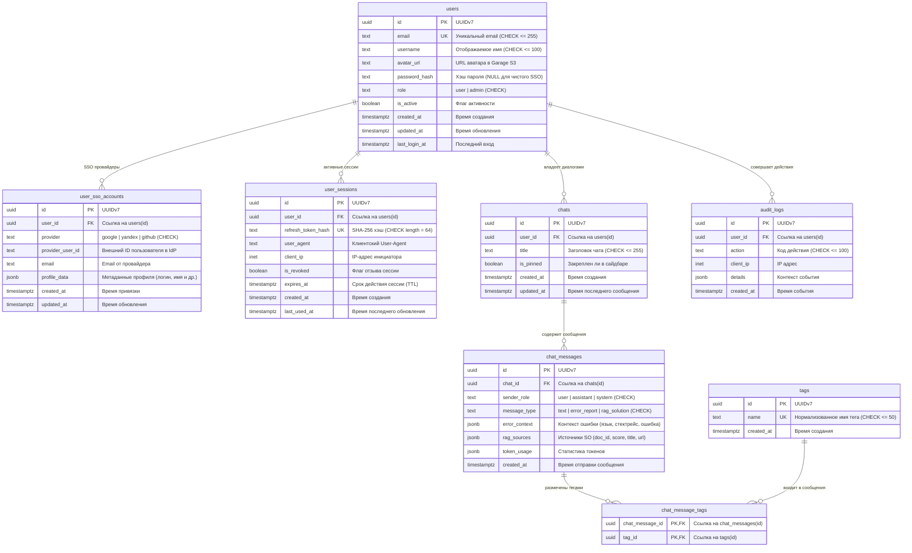

# 03-data.md — Хранение данных, форматы индексов и графа знаний

## 1. Структура инвертированного индекса (`data/index/`)

Индекс формируется офлайн сервисом `search_engine_indexer` и читается сервисом `search_engine_core` в режиме `read-only` с использованием механизма `mmap`.

```text
data/index/
├── lexicon.bin         # Словарь терминов: [term_id (uint32), term_str, offset (uint64), df (uint32)]
├── postings.bin        # Списки постингов: [doc_id (uint32), tf (uint16), [positions...]]
├── doc_lengths.bin     # Таблица длин документов: [doc_id -> length (uint16)], а также N и avgdl
├── metadata.json       # Общая статистика: N, avgdl, timestamp, версия токенизатора
└── graph.db            # Локальная база данных связей графа тредов (SQLite)
```

### Формат записи Posting List
Для каждого термина $t$:
$$\text{Posting} = \langle doc\_id, tf \rangle$$
При сжатии используется дельта-кодирование $\Delta doc\_id = doc\_id_{i} - doc\_id_{i-1}$ с переменной длиной байта (VByte / Varint) для минимизации размера на диске.

---

## 2. Граф связанных тредов (`graph.db`)

Связи графа формируются индексатором и сохраняются в легковесной встраиваемой базе данных SQLite (`data/index/graph.db`).
Такой подход устраняет необходимость ручного управления бинарными смещениями и гарантирует мгновенную точечную выборку 1-hop/2-hop окрестностей по B-Tree индексу ($< 1$ мс).

### Схема базы данных `graph.db`

#### Таблица связей `thread_links` (Ребра графа)
```sql
CREATE TABLE thread_links (
    source_doc_id INTEGER NOT NULL,
    target_doc_id INTEGER NOT NULL,
    link_type     TEXT NOT NULL,    -- 'DUPLICATE_OF' | 'LINKED_IN_ANSWER'
    weight        REAL DEFAULT 1.0,
    PRIMARY KEY (source_doc_id, target_doc_id, link_type)
);

CREATE INDEX idx_thread_links_source ON thread_links(source_doc_id);
CREATE INDEX idx_thread_links_target ON thread_links(target_doc_id);
```

#### Таблица метаданных `thread_nodes` (Узлы графа и детали)
```sql
CREATE TABLE thread_nodes (
    doc_id              INTEGER PRIMARY KEY,
    title               TEXT NOT NULL,
    snippet             TEXT NOT NULL,
    has_accepted_answer BOOLEAN DEFAULT FALSE,
    tags                TEXT,         -- сериализованный JSON-список, например '["java", "spring"]'
    question_score      INTEGER DEFAULT 0,
    best_answer_score   INTEGER DEFAULT 0,
    best_answer_body    TEXT          -- полный текст ответа (для GetThreadDetails)
);
```

- **Запись (Роль 1, `search_engine_indexer`):** 
  - Пакетная вставка связей транзакциями при потоковом разборе `PostLinks.xml`.
  - Заполнение метаданных узлов при разборе `Posts.xml`.
- **Чтение (Роль 2, `search_engine_core`):** 
  - Выборка подграфа в режиме read-only (`file:data/index/graph.db?mode=ro`):
    1. Нахождение смежных ID:
       ```sql
       SELECT target_doc_id, link_type, weight FROM thread_links WHERE source_doc_id IN (?, ?, ...);
       ```
    2. Извлечение метаданных для всех узлов окрестности:
       ```sql
       SELECT doc_id, title, snippet, has_accepted_answer, tags, question_score, best_answer_score 
       FROM thread_nodes WHERE doc_id IN (?, ?, ...);
       ```
    3. Выборка деталей треда по клику (`GetThreadDetails`):
       ```sql
       SELECT title, best_answer_body FROM thread_nodes WHERE doc_id = ?;
       ```

---

## 3. База данных пользователей, сессий и чатов Gateway (PostgreSQL)

В качестве СУБД для сервиса `gateway` используется **PostgreSQL 18+**.
Все первичные ключи используют стандарт **UUIDv7** с нативным встроенным генератором `uuidv7()` ядра PostgreSQL (time-ordered идентификаторы, обеспечивающие естественную хронологическую сортировку B-Tree индексов без фрагментации).

### 3.1. Схема таблиц



### 3.2. Описание таблиц и ограничений

1. **`users`:** Учетные записи пользователей.
   - `id`: UUID (UUIDv7, PK).
   - `email`: TEXT NOT NULL UNIQUE CHECK (length(email) <= 255).
   - `username`: TEXT NOT NULL CHECK (length(username) <= 100).
   - `avatar_url`: TEXT NULL — ссылка на объект в S3/Garage хранилище.
   - `password_hash`: TEXT NULL CHECK (password_hash IS NULL OR length(password_hash) <= 255) — хэш пароля. Для SSO-пользователей `NULL`.
   - `role`: TEXT NOT NULL DEFAULT 'user' CHECK (role IN ('user', 'admin')).
   - `is_active`: BOOLEAN NOT NULL DEFAULT TRUE.
   - `created_at`, `updated_at`: TIMESTAMPTZ NOT NULL DEFAULT NOW().
   - `last_login_at`: TIMESTAMPTZ NULL.
   - Индексы: `idx_users_email` (UNIQUE), `idx_users_role`.

2. **`user_sso_accounts`:** Привязанные SSO-аккаунты.
   - `provider`: TEXT NOT NULL CHECK (provider IN ('google', 'yandex', 'github')).
   - `provider_user_id`: TEXT NOT NULL CHECK (length(provider_user_id) <= 255).
   - `email`: TEXT NULL CHECK (email IS NULL OR length(email) <= 255).
   - `profile_data`: JSONB NOT NULL DEFAULT '{}'::jsonb.
   - Ограничения: `UNIQUE (provider, provider_user_id)`, `FOREIGN KEY (user_id) REFERENCES users(id) ON DELETE CASCADE`.
   - Индексы: `idx_sso_user_id`.

3. **`user_sessions`:** Активные пользовательские сессии и хэши refresh-токенов.
   - `refresh_token_hash`: TEXT NOT NULL UNIQUE CHECK (length(refresh_token_hash) = 64) — SHA-256 в hex.
   - `user_agent`: TEXT NULL, `client_ip`: INET NULL.
   - `is_revoked`: BOOLEAN NOT NULL DEFAULT FALSE.
   - `expires_at`: TIMESTAMPTZ NOT NULL, `last_used_at`: TIMESTAMPTZ NOT NULL DEFAULT NOW().
   - Ограничения: `FOREIGN KEY (user_id) REFERENCES users(id) ON DELETE CASCADE`.
   - Индексы: `idx_sessions_user_id`, `idx_sessions_active_expiry` (частичный по `WHERE is_revoked = FALSE`).

4. **`chats`:** Диалоги и история запросов в Web UI (`Recent chats`).
   - `title`: TEXT NOT NULL DEFAULT 'Новый чат' CHECK (length(title) <= 255).
   - `is_pinned`: BOOLEAN NOT NULL DEFAULT FALSE.
   - Ограничения: `FOREIGN KEY (user_id) REFERENCES users(id) ON DELETE CASCADE`.
   - Индексы: `idx_chats_user_updated` (`(user_id, updated_at DESC)`), `idx_chats_title_trgm` (GIN триграммный поиск).

5. **`chat_messages`:** Сообщения в диалоге (запросы пользователей и ответы RAG).
   - `sender_role`: TEXT NOT NULL CHECK (sender_role IN ('user', 'assistant', 'system')).
   - `message_type`: TEXT NOT NULL DEFAULT 'error_report' CHECK (message_type IN ('text', 'error_report', 'rag_solution')).
   - `error_context`: JSONB NULL (тип ошибки, стектрейс, язык, исходный ввод).
   - `rag_sources`: JSONB NULL (массив объектов `[{doc_id, title, score, url, snippet}]`).
   - `token_usage`: JSONB NULL (`{prompt_tokens, completion_tokens, total_tokens}`).
   - Ограничения: `FOREIGN KEY (chat_id) REFERENCES chats(id) ON DELETE CASCADE`.
   - Индексы: `idx_messages_chat_created` (`(chat_id, created_at ASC)`).

6. **`tags` и `chat_message_tags`:** Нормализованный каталог тегов.
   - `tags`: `id` (UUIDv7, PK), `name` TEXT NOT NULL UNIQUE CHECK (length(name) <= 50), `created_at` TIMESTAMPTZ.
   - `chat_message_tags`: `(chat_message_id, tag_id)` (PK), внешние ключи с `ON DELETE CASCADE`. Индекс `idx_cmt_tag_id`.

7. **`audit_logs`:** Журнал безопасности и административных действий.
   - `action`: TEXT NOT NULL CHECK (length(action) <= 100), `details`: JSONB NOT NULL DEFAULT '{}'::jsonb.
   - Индексы: `idx_audit_logs_user_id`, `idx_audit_logs_created_at DESC`.

### 3.3. Объектное хранилище аватарок (Garage / S3)

Для хранения загружаемых аватарок пользователей используется совместимое с Amazon S3 объектное хранилище **Garage**:
- **Бакет:** `errorium-avatars` (публичный доступ на чтение по CDN/HTTP URL).
- **Путь к объекту:** `avatars/{user_id}/{hash}.webp` (изображения пережимаются в формат WebP на стороне Gateway).
- **Ссылка в БД:** В поле `users.avatar_url` сохраняется постоянный HTTP-адрес объекта (например, `https://errorium.ru/storage/avatars/{user_id}/{hash}.webp` или `http://localhost:3900/...`).

### 3.4. Политика авторизации для MCP (Model Context Protocol)

- **Авторизация для Remote MCP отсутствует:** вызовы `GET /sse` и обработка запросов AI-агентов производятся в открытом режиме без Bearer токенов и без привязки к пользователю.
- Таблицы `mcp_tokens` в БД **нет**.

### 3.5. Механизм версионирования и применения миграций (embed.FS)

Миграции схемы БД встроены непосредственно в исполняемый файл Gateway с помощью механизма Go **`embed.FS`** (`services/gateway/migrations/migrations.go`).
- **Автоматический накат при старте:** При запуске Gateway считывает `AUTO_MIGRATE=true` (по умолчанию включено), подключается к PostgreSQL и атомарно накатывает ожидающие `.up.sql` миграции через драйвер `golang-migrate/v4/source/iofs`.
- **Изоляция инфраструктуры:** Контейнер `postgres` в `docker-compose` остается полностью чистым от скриптов инициализации (устранен антипаттерн разового монтирования в `/docker-entrypoint-initdb.d/`), а версионирование схемы (`schema_migrations`) ведется стандартными средствами мигратора.

---

## 4. Источник данных Stack Overflow и стратегия формирования корпуса (Indexer, Роль 1)

### 4.1. Факты об исходном архиве (измерены 2026-11-18)

Источник — официальный дамп Stack Exchange `stackoverflow.com.7z` (68 946 936 349 байт ≈ 64 ГиБ). Архив **несолидный**: 10 независимых блоков LZMA2:22, каждый файл извлекается отдельно, без чтения соседних.

| Файл в архиве | Распаковано | Используется |
| :--- | :--- | :--- |
| `Posts.xml` | 105.6 ГБ (24.14 млн вопросов, 36.08 млн ответов, по ~57 тыс. tag-wiki типов 4 и 5) | Да (поток) |
| `PostLinks.xml` | 0.8 ГБ | Да (поток) |
| `Tags.xml` | 5.9 МБ | Да |
| `PostHistory.xml`, `Comments.xml`, `Votes.xml`, `Users.xml`, `Badges.xml` | 185 / 28 / 24 / 8 / 6.5 ГБ | **Нет** |

Формат `Posts.xml`: UTF-8 с BOM, окончания строк CRLF, одна запись `<row .../>` на строку, текст в атрибутах экранирован XML-сущностями (`&lt;`, `&amp;`, `&#xA;`). Поле `Tags` имеет вид `<c++><c#><.net>`.

**Порядок записей:** `Posts.xml` **не отсортирован по `Id`**; вопросы и ответы перемешаны крупными блоками по всему файлу (первые `Id` по 5-гибибайтным блокам: 145, 7.2 млн, 11.6 млн, 11.5 млн, 32.5 млн, ...), а ответ не обязан лежать рядом со своим вопросом. На префиксе 3 ГиБ у 48% вопросов есть `AcceptedAnswerId`, но сам принятый ответ найден лишь в 12% случаев. Следовательно, **префиксный срез («первые N ГБ») запрещён как способ формирования корпуса**: он даёт вопросы без ответов и смещён в ранние годы.

### 4.2. Принцип: поток без распаковки на диск

- Сырые XML **никогда не распаковываются на диск целиком**. Индексатор читает файл потоком: `7zz x -so <archive> Posts.xml` (stdout), в обработку попадает построчный итератор.
- Допустимы два источника, выбираются автоматически: (а) архив `SO_DUMP_ARCHIVE` (по умолчанию), (б) уже распакованные `Posts.xml` / `PostLinks.xml` / `Tags.xml` в `RAW_DATA_PATH`.
- Контейнер индексатора содержит 7-Zip (`7zz`) и монтирует каталог с архивом **только на чтение**. Ограничение хост-окружения (Docker + Make) сохраняется.
- Пропускная способность потока ≈ 180 МБ/с и выше; полный проход `Posts.xml` ≈ 10 минут на 4 ядрах. Это дёшево, поэтому стратегия ниже допускает несколько проходов.

### 4.3. Документ и состав корпуса

- **Документ = тред Stack Overflow:** `doc_id` = `Id` вопроса (`PostTypeId=1`). Это согласуется с `SearchHit.doc_id` в `protos/search.proto`.
- **Тред валиден**, если есть `AcceptedAnswerId` и запись ответа с этим `Id` присутствует в потоке. Фильтр качества: `Score >= SAMPLE_MIN_SCORE` (по умолчанию 1). Тред без принятого ответа в корпус не входит (в `graph.db` ему нечего показывать по клику).
- **Индексируемый текст** (предложение; согласуется с Ролью 2 до КТ2): `Title` + `Body` вопроса + `Body` принятого ответа, HTML снят, содержимое `<code>`/`<pre>` сохранено как токены кода (правила токенизатора — `AGENTS.md`, п. 2.3). `thread_nodes.best_answer_body` = тело принятого ответа.
- Типы постов 3–7 (tag-wiki, мод-посты) игнорируются.

### 4.4. Режимы работы (`INDEX_MODE`)

| Режим | Контрольная точка | Что обрабатывается | Бюджет диска (оценка) |
| :--- | :--- | :--- | :--- |
| `sample` | КТ2 | Детерминированная случайная выборка тредов + их соседи по графу | ≈ 2 ГиБ при `SAMPLE_DENOM=100` |
| `full` | КТ3 | Весь корпус по шардам (4.6) | Уточняется по итогам КТ2 (в первом приближении ≈ 100× от размера индекса КТ2) |

### 4.5. Режим `sample`: хеш-выборка + расширение графа

Выборка по хешу идентификатора треда равномерна по годам, тегам и языкам и воспроизводима. Хеш:

```text
h(id) = (id * 2654435761) mod 2^32        # мультипликативный хеш Кнута
в выборке S:  h(id) mod SAMPLE_DENOM == SAMPLE_RESIDUE   # по умолчанию 100 и 0
```

Для ответа проверяется хеш `ParentId` (а не собственного `Id`), поэтому вопрос и его ответы попадают в выборку вместе независимо от порядка строк в файле, и состояние между строками не хранится.

> [!IMPORTANT]
> Простая выборка 1% разрушает граф: ребро `PostLinks` выживает с вероятностью $p^2 = 10^{-4}$. Поэтому корпус расширяется соседями по связям, а рёбра графа строятся только между документами корпуса.

Алгоритм (воспроизводимый, ≈ 12–15 минут суммарно):

1. **Проход 0 — `PostLinks.xml` (0.8 ГБ, ~1 мин).** Для каждой связи, у которой хотя бы один конец (`PostId` или `RelatedPostId`) входит в `S`, добавить второй конец в множество соседей $N(S)$ (не более `GRAPH_MAX_NEIGHBORS=20` на узел, чтобы хабы с тысячами дубликатов не раздували корпус). Корпус $C = S \cup N(S)$ — множество идентификаторов, в памяти ≈ 10–50 МБ.
2. **Проход 1 — `Posts.xml` (весь поток, ≈ 10 мин).** Записать в `data/raw/sample/Posts.sample.xml` строки, где `PostTypeId=1` и `Id ∈ C`, либо `PostTypeId=2` и `ParentId ∈ C`. Строки пишутся как есть (CRLF/BOM нормализуются); ожидаемый размер ≈ 1 ГиБ при `SAMPLE_DENOM=100`.
3. **Проход 2 — `Tags.xml` и `PostLinks.xml`.** `Tags.xml` копируется целиком; из `PostLinks.xml` оставляются связи, у которых **оба** конца — валидные треды корпуса (после применения фильтра 4.3).
4. **Сборка документов (SPIMI).** Из `Posts.sample.xml` соединяются вопрос и его принятый ответ, невалидные треды отбрасываются, остальное идёт в токенизатор и построение индекса (форматы артефактов — разделы 1–2 выше).
5. **Манифест выборки** `data/index/sample_manifest.json`: `SAMPLE_DENOM`, `SAMPLE_RESIDUE`, `SAMPLE_MIN_SCORE`, `GRAPH_MAX_NEIGHBORS`, размер и имя архива, версия `7zz`, число строк по типам, число валидных тредов и рёбер, SHA-256 `Posts.sample.xml`. Одинаковые параметры обязаны давать побайтно одинаковый `Posts.sample.xml`.

Ожидания по объёму при `SAMPLE_DENOM=100` (оценки, подлежат замеру): ~241 тыс. вопросов в $S$, около половины с принятым ответом; корпус 100–150 тыс. валидных тредов; $N(S)$ порядка 10^5.

### 4.6. Режим `full` (КТ3): шардирование по хешу

Весь корпус (24 млн тредов) не помещается в ОЗУ ≤ 4 ГБ. Режим `full` — это `sample`-проход, повторённый для `K` непересекающихся шардов (`SHARD_COUNT=K`, шард `r` берёт треды с `h(id) mod K == r`, без расширения соседями):

1. Граф строится **один раз глобально** из `PostLinks.xml` (0.8 ГБ, помещается в SQLite транзакциями), без привязки к шардам.
2. Для каждого шарда `r = 0..K-1` — один потоковый проход `Posts.xml` с отбором по хешу, соединение вопрос+ответ в памяти, токенизация, сброс **блока SPIMI** на диск.
3. Блоки всех шардов сливаются многопутевым слиянием в итоговые `lexicon.bin` / `postings.bin` / `doc_lengths.bin`.
4. Шарды могут обрабатываться независимо и возобновляться после сбоя (список готовых шардов хранится в `data/index/build_state.json`).

> [!NOTE]
> Блоки SPIMI и итоговый индекс полного корпуса оцениваются в десятки ГБ; перед запуском `full` проверьте свободное место. Если корпус целиком не нужен, достаточно `INDEX_MODE=sample` с большей долей (например, `SAMPLE_DENOM=10`).

### 4.7. Переменные окружения индексатора

| Переменная | По умолчанию | Назначение |
| :--- | :--- | :--- |
| `INDEX_MODE` | `sample` | `sample` или `full` |
| `SO_DUMP_ARCHIVE` | _(пусто)_ | Путь к `stackoverflow.com.7z` внутри контейнера (монтируется `:ro`) |
| `RAW_DATA_PATH` | `/app/data/raw` | Каталог с распакованными XML, если архив не задан; также каталог `sample/` |
| `INDEX_OUTPUT_PATH` | `/app/data/index` | Каталог артефактов индекса |
| `SAMPLE_DENOM` | `100` | Знаменатель доли выборки (1/DENOM тредов) |
| `SAMPLE_RESIDUE` | `0` | Остаток хеша, определяющий выборку |
| `SAMPLE_MIN_SCORE` | `1` | Минимальный `Score` вопроса |
| `GRAPH_MAX_NEIGHBORS` | `20` | Предел соседей на узел при расширении |
| `SHARD_COUNT` | `64` | Число шардов в режиме `full` |

### 4.8. Критерии приёмки и верификация

- **Память:** пик ОЗУ ≤ 4 ГБ на любом проходе (`docker stats`).
- **Диск:** распакованные XML не появляются на диске; в режиме `sample` занято ≤ 3 ГиБ суммарно (`data/raw/sample/` + `data/index/`).
- **Детерминизм:** два запуска с одинаковыми параметрами дают одинаковые SHA-256 `Posts.sample.xml` и `sample_manifest.json` (кроме timestamp).
- **Unit-тесты** (`tests/unit/test_sampler.py`, на малой синтетической фикстуре XML с BOM, CRLF и сущностями): стабильность `h(id)`; ответ попадает в выборку вместе с вопросом при любом порядке строк; фильтры `PostTypeId`, `AcceptedAnswerId`, `Score`; ограничение `GRAPH_MAX_NEIGHBORS`; рёбра только между документами корпуса; корректный разбор `Tags` вида `<c++><c#>`.
- **Интеграционный прогон** на реальном архиве: индексация в режиме `sample` (через `make`, цель будет добавлена вместе с кодом) завершается за ≤ 20 минут; в манифесте число валидных тредов ≥ 50 тыс. (достаточно для benchmark КТ2: 30 документов, 10 + 5 вопросов, ≥ 3 релевантных документа на вопрос).


