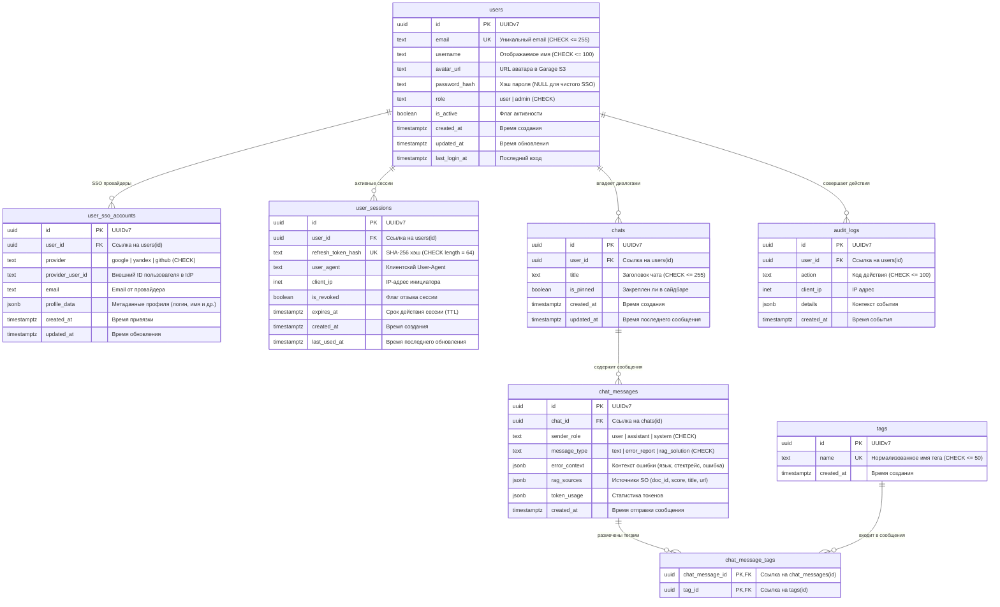

# 03-data.md — Хранение данных, форматы индексов и графа знаний

## 1. Структура инвертированного индекса (`data/index/`)

Индекс формируется офлайн сервисом `search_engine_indexer` и читается сервисом `search_engine_core` в режиме `read-only` с использованием механизма `mmap`.

```text
data/index/
├── lexicon.bin         # Словарь: отсортированные по байтам UTF-8 термы с df и положением списка постингов
├── postings.bin        # Сжатые списки постингов <doc_id, tf> (VByte, дельта по doc_id)
├── doc_lengths.bin     # Длины документов |d| в токенах: пары <doc_id, length>, отсортированы по doc_id
├── metadata.json       # Общая статистика: N, avgdl, размер словаря, версии, timestamp
└── graph.db            # Локальная база данных связей графа тредов (SQLite)
```

### 1.1. Бинарный контракт (версия формата `1`)

Контракт между Ролью 1 (запись) и Ролью 2 (чтение). Все целые — **little-endian**; `varint` — LEB128: 7 бит данных на байт, младшие группы первыми, старший бит байта = «есть следующий байт». Термы — UTF-8, нижний регистр (`casefold`), результат токенизатора из раздела 5; $doc\_id$ — `Id` вопроса Stack Overflow (`uint32`).

**`lexicon.bin`**
```text
header:  magic "ELX1" (4 байта) | format_version uint32 = 1 | vocab_size uint32
record × vocab_size, строго по возрастанию терма (сравнение байтов UTF-8):
         term_len uint16 | term (term_len байт) | df uint32 | offset uint64 | length uint32
```
`offset` и `length` — положение (в байтах) списка постингов терма в `postings.bin`. Ядро читает файл последовательно при старте и строит хеш-таблицу `терм -> (df, offset, length)`; файл отсортирован, что допускает и бинарный поиск по `mmap` после построения таблицы смещений.

**`postings.bin`**
```text
header:  magic "EPS1" (4 байта) | format_version uint32 = 1
далее списки постингов подряд (границы — из lexicon.bin).
список терма с df документами: df пар, документы по возрастанию doc_id:
         varint(doc_id_i − doc_id_{i−1})  varint(tf_i)       # для i = 0 предыдущий doc_id = 0
```
Позиции токенов не хранятся (КТ2). Число пар в списке равно $DF(t)$ из `lexicon.bin`. $TF$ хранится как `varint` без ограничения 16 бит.

**`doc_lengths.bin`**
```text
header:  magic "EDL1" (4 байта) | format_version uint32 = 1 | N uint32
record × N, по возрастанию doc_id:  doc_id uint32 | length uint32
```
$length = |d|$ — число всех эмитированных токенов документа (п. 5.4). $N$ и $avgdl = \frac{1}{N}\sum_d |d|$ дублируются в `metadata.json`.

**`metadata.json`**
```json
{
  "format_version": 1,
  "tokenizer_version": "1",
  "index_mode": "sample",
  "num_documents": 0,
  "avg_doc_length": 0.0,
  "total_tokens": 0,
  "vocabulary_size": 0,
  "build_timestamp": 0,
  "source": {}
}
```
Ядро обязано отказаться загружать индекс, если `format_version` или `tokenizer_version` не поддерживаются, и считать $N$ и $avgdl$ из этого файла (а не пересчитывать). Поле `source` содержит параметры выборки и ссылку на `sample_manifest.json` (раздел 4.5).

### 1.2. Построение (SPIMI)

1. Документы поступают в порядке возрастания `doc_id` (режим `sample`) или произвольно (режим `full`, шарды пересекаются по диапазону `doc_id`). Для каждого документа токенизатор строит текст `Title + очищенный Body вопроса + очищенный Body принятого ответа` (п. 4.3, 5.1).
2. Токены накапливаются в блоке в памяти: `терм -> [(doc_id, tf)]`. Блок сбрасывается на диск во временный файл (внутренний формат индексатора, не контракт), как только число накопленных постингов превысит `SPIMI_BLOCK_POSTINGS` (по умолчанию 2 000 000; это держит пик ОЗУ в пределах бюджета ≤ 4 ГБ).
3. Блоки сливаются k-way слиянием по терму; постинги одного терма из разных блоков склеиваются по возрастанию `doc_id` (каждый документ лежит ровно в одном блоке, поэтому суммирование `tf` не требуется). Результат пишется потоком в `postings.bin` и `lexicon.bin`, затем записываются `doc_lengths.bin` и `metadata.json`; временные блоки удаляются.
4. Атомарность: каталог индекса может быть точкой монтирования тома, поэтому его нельзя переименовать. Файлы собираются в `<INDEX_OUTPUT_PATH>/.building/`, затем переносятся на место через `os.replace`, а **`metadata.json` записывается последним и служит маркером готовности**: индекс без `metadata.json` считается неполным, ядро не должно его загружать. Дополнительные артефакты (`graph.db`, `sample_manifest.json`) готовятся индексатором заранее во временном каталоге и публикуются тем же шагом, **до** маркера: либо ядро видит новый индекс целиком, либо прежний.

---

## 2. Граф связанных тредов (`graph.db`)

Связи графа формируются индексатором и сохраняются в легковесной встраиваемой базе данных SQLite (`data/index/graph.db`).
Такой подход устраняет необходимость ручного управления бинарными смещениями и гарантирует мгновенную точечную выборку 1-hop/2-hop окрестностей по B-Tree индексу ($< 1$ мс).

### Схема базы данных `graph.db`

#### Таблица связей `thread_links` (Ребра графа)
```sql
CREATE TABLE thread_links (
    source_doc_id INTEGER NOT NULL,
    target_doc_id INTEGER NOT NULL,
    link_type     TEXT NOT NULL,    -- 'DUPLICATE_OF' | 'LINKED_IN_ANSWER'
    weight        REAL DEFAULT 1.0,
    PRIMARY KEY (source_doc_id, target_doc_id, link_type)
);

CREATE INDEX idx_thread_links_source ON thread_links(source_doc_id);
CREATE INDEX idx_thread_links_target ON thread_links(target_doc_id);
```

#### Таблица метаданных `thread_nodes` (Узлы графа и детали)
```sql
CREATE TABLE thread_nodes (
    doc_id              INTEGER PRIMARY KEY,
    title               TEXT NOT NULL,
    snippet             TEXT NOT NULL,
    has_accepted_answer BOOLEAN DEFAULT FALSE,
    tags                TEXT,         -- сериализованный JSON-список, например '["java", "spring"]'
    question_score      INTEGER DEFAULT 0,
    best_answer_score   INTEGER DEFAULT 0,
    best_answer_body    TEXT,         -- полный текст ответа (для GetThreadDetails)
    accepted_answer_id  INTEGER DEFAULT 0,  -- Id принятого ответа (0, если нет); SearchHit.accepted_answer_id
    created_at          INTEGER DEFAULT 0   -- дата создания вопроса, Unix-время UTC (с); SearchHit.created_at
);
```

Содержимое полей `thread_nodes` (контракт Роли 1 → Роли 2):
- `snippet` — текст вопроса после `clean_html` (п. 5.1), пробельные символы схлопнуты, длина ≤ 300 символов (при обрезке в конце `…`).
- `best_answer_body` — тело принятого ответа **как в дампе (HTML)**: подсветка кода на фронтенде опирается на `<pre><code>`; санитизацию HTML перед выводом выполняют Gateway/Frontend.
- `tags` — JSON-массив строк (`["c#", ".net"]`); `has_accepted_answer` — `1` для тредов выборки и `0` для документов режима `corpus`.
- Файл создаётся индексатором целиком (без инкрементальных обновлений) и публикуется вместе с остальными артефактами индекса (п. 1.2, шаг 4).

- **Запись (Роль 1, `search_engine_indexer`):** 
  - Пакетная вставка связей транзакциями при потоковом разборе `PostLinks.xml`.
  - Заполнение метаданных узлов при разборе `Posts.xml`.
- **Чтение (Роль 2, `search_engine_core`):** 
  - Выборка подграфа в режиме read-only (`file:data/index/graph.db?mode=ro`):
    1. Нахождение смежных ID:
       ```sql
       SELECT target_doc_id, link_type, weight FROM thread_links WHERE source_doc_id IN (?, ?, ...);
       ```
    2. Извлечение метаданных для всех узлов окрестности:
       ```sql
       SELECT doc_id, title, snippet, has_accepted_answer, tags, question_score, best_answer_score 
       FROM thread_nodes WHERE doc_id IN (?, ?, ...);
       ```
    3. Выборка деталей треда по клику (`GetThreadDetails`):
       ```sql
       SELECT title, best_answer_body FROM thread_nodes WHERE doc_id = ?;
       ```

---

## 3. База данных пользователей, сессий и чатов Gateway (PostgreSQL)

В качестве СУБД для сервиса `gateway` используется **PostgreSQL 18+**.
Все первичные ключи используют стандарт **UUIDv7** с нативным встроенным генератором `uuidv7()` ядра PostgreSQL (time-ordered идентификаторы, обеспечивающие естественную хронологическую сортировку B-Tree индексов без фрагментации).

### 3.1. Схема таблиц



### 3.2. Описание таблиц и ограничений

1. **`users`:** Учетные записи пользователей.
   - `id`: UUID (UUIDv7, PK).
   - `email`: TEXT NOT NULL UNIQUE CHECK (length(email) <= 255).
   - `username`: TEXT NOT NULL CHECK (length(username) <= 100).
   - `avatar_url`: TEXT NULL — ссылка на объект в S3/Garage хранилище.
   - `password_hash`: TEXT NULL CHECK (password_hash IS NULL OR length(password_hash) <= 255) — хэш пароля. Для SSO-пользователей `NULL`.
   - `role`: TEXT NOT NULL DEFAULT 'user' CHECK (role IN ('user', 'admin')).
   - `is_active`: BOOLEAN NOT NULL DEFAULT TRUE.
   - `created_at`, `updated_at`: TIMESTAMPTZ NOT NULL DEFAULT NOW().
   - `last_login_at`: TIMESTAMPTZ NULL.
   - Индексы: `idx_users_email` (UNIQUE), `idx_users_role`.

2. **`user_sso_accounts`:** Привязанные SSO-аккаунты.
   - `provider`: TEXT NOT NULL CHECK (provider IN ('google', 'yandex', 'github')).
   - `provider_user_id`: TEXT NOT NULL CHECK (length(provider_user_id) <= 255).
   - `email`: TEXT NULL CHECK (email IS NULL OR length(email) <= 255).
   - `profile_data`: JSONB NOT NULL DEFAULT '{}'::jsonb.
   - Ограничения: `UNIQUE (provider, provider_user_id)`, `FOREIGN KEY (user_id) REFERENCES users(id) ON DELETE CASCADE`.
   - Индексы: `idx_sso_user_id`.

3. **`user_sessions`:** Активные пользовательские сессии и хэши refresh-токенов.
   - `refresh_token_hash`: TEXT NOT NULL UNIQUE CHECK (length(refresh_token_hash) = 64) — SHA-256 в hex.
   - `user_agent`: TEXT NULL, `client_ip`: INET NULL.
   - `is_revoked`: BOOLEAN NOT NULL DEFAULT FALSE.
   - `expires_at`: TIMESTAMPTZ NOT NULL, `last_used_at`: TIMESTAMPTZ NOT NULL DEFAULT NOW().
   - Ограничения: `FOREIGN KEY (user_id) REFERENCES users(id) ON DELETE CASCADE`.
   - Индексы: `idx_sessions_user_id`, `idx_sessions_active_expiry` (частичный по `WHERE is_revoked = FALSE`).

4. **`chats`:** Диалоги и история запросов в Web UI (`Recent chats`).
   - `title`: TEXT NOT NULL DEFAULT 'Новый чат' CHECK (length(title) <= 255).
   - `is_pinned`: BOOLEAN NOT NULL DEFAULT FALSE.
   - Ограничения: `FOREIGN KEY (user_id) REFERENCES users(id) ON DELETE CASCADE`.
   - Индексы: `idx_chats_user_updated` (`(user_id, updated_at DESC)`), `idx_chats_title_trgm` (GIN триграммный поиск).

5. **`chat_messages`:** Сообщения в диалоге (запросы пользователей и ответы RAG).
   - `sender_role`: TEXT NOT NULL CHECK (sender_role IN ('user', 'assistant', 'system')).
   - `message_type`: TEXT NOT NULL DEFAULT 'error_report' CHECK (message_type IN ('text', 'error_report', 'rag_solution')).
   - `error_context`: JSONB NULL (тип ошибки, стектрейс, язык, исходный ввод).
   - `rag_sources`: JSONB NULL (массив объектов `[{doc_id, title, score, url, snippet}]`).
   - `token_usage`: JSONB NULL (`{prompt_tokens, completion_tokens, total_tokens}`).
   - Ограничения: `FOREIGN KEY (chat_id) REFERENCES chats(id) ON DELETE CASCADE`.
   - Индексы: `idx_messages_chat_created` (`(chat_id, created_at ASC)`).

6. **`tags` и `chat_message_tags`:** Нормализованный каталог тегов.
   - `tags`: `id` (UUIDv7, PK), `name` TEXT NOT NULL UNIQUE CHECK (length(name) <= 50), `created_at` TIMESTAMPTZ.
   - `chat_message_tags`: `(chat_message_id, tag_id)` (PK), внешние ключи с `ON DELETE CASCADE`. Индекс `idx_cmt_tag_id`.

7. **`audit_logs`:** Журнал безопасности и административных действий.
   - `action`: TEXT NOT NULL CHECK (length(action) <= 100), `details`: JSONB NOT NULL DEFAULT '{}'::jsonb.
   - Индексы: `idx_audit_logs_user_id`, `idx_audit_logs_created_at DESC`.

### 3.3. Объектное хранилище аватарок (Garage / S3)

Для хранения загружаемых аватарок пользователей используется совместимое с Amazon S3 объектное хранилище **Garage**:
- **Бакет:** `errorium-avatars` (публичный доступ на чтение по CDN/HTTP URL).
- **Путь к объекту:** `avatars/{user_id}/{hash}.webp` (изображения пережимаются в формат WebP на стороне Gateway).
- **Ссылка в БД:** В поле `users.avatar_url` сохраняется постоянный HTTP-адрес объекта (например, `https://errorium.ru/storage/avatars/{user_id}/{hash}.webp` или `http://localhost:3900/...`).

### 3.4. Политика авторизации для MCP (Model Context Protocol)

- **Авторизация для Remote MCP отсутствует:** вызовы `GET /sse` и обработка запросов AI-агентов производятся в открытом режиме без Bearer токенов и без привязки к пользователю.
- Таблицы `mcp_tokens` в БД **нет**.

### 3.5. Механизм версионирования и применения миграций (embed.FS)

Миграции схемы БД встроены непосредственно в исполняемый файл Gateway с помощью механизма Go **`embed.FS`** (`services/gateway/migrations/migrations.go`).
- **Автоматический накат при старте:** При запуске Gateway считывает `AUTO_MIGRATE=true` (по умолчанию включено), подключается к PostgreSQL и атомарно накатывает ожидающие `.up.sql` миграции через драйвер `golang-migrate/v4/source/iofs`.
- **Изоляция инфраструктуры:** Контейнер `postgres` в `docker-compose` остается полностью чистым от скриптов инициализации (устранен антипаттерн разового монтирования в `/docker-entrypoint-initdb.d/`), а версионирование схемы (`schema_migrations`) ведется стандартными средствами мигратора.

---

## 4. Источник данных Stack Overflow и стратегия формирования корпуса (Indexer, Роль 1)

### 4.1. Факты об исходном архиве (измерены 2026-11-18)

Источник — официальный дамп Stack Exchange `stackoverflow.com.7z` (68 946 936 349 байт ≈ 64 ГиБ). Архив **несолидный**: 10 независимых блоков LZMA2:22, каждый файл извлекается отдельно, без чтения соседних.

| Файл в архиве | Распаковано | Используется |
| :--- | :--- | :--- |
| `Posts.xml` | 105.6 ГБ (24.14 млн вопросов, 36.08 млн ответов, по ~57 тыс. tag-wiki типов 4 и 5) | Да (поток) |
| `PostLinks.xml` | 0.8 ГБ | Да (поток) |
| `Tags.xml` | 5.9 МБ | Да |
| `PostHistory.xml`, `Comments.xml`, `Votes.xml`, `Users.xml`, `Badges.xml` | 185 / 28 / 24 / 8 / 6.5 ГБ | **Нет** |

Формат `Posts.xml`: UTF-8 с BOM, окончания строк CRLF, одна запись `<row .../>` на строку, текст в атрибутах экранирован XML-сущностями (`&lt;`, `&amp;`, `&#xA;`). Поле `Tags` имеет вид `<c++><c#><.net>`.

**Порядок записей:** `Posts.xml` **не отсортирован по `Id`**; вопросы и ответы перемешаны крупными блоками по всему файлу (первые `Id` по 5-гибибайтным блокам: 145, 7.2 млн, 11.6 млн, 11.5 млн, 32.5 млн, ...), а ответ не обязан лежать рядом со своим вопросом. На префиксе 3 ГиБ у 48% вопросов есть `AcceptedAnswerId`, но сам принятый ответ найден лишь в 12% случаев. Следовательно, **префиксный срез («первые N ГБ») запрещён как способ формирования корпуса**: он даёт вопросы без ответов и смещён в ранние годы.

### 4.2. Принцип: поток без распаковки на диск

- Сырые XML **никогда не распаковываются на диск целиком**. Индексатор читает файл потоком: `7zz x -so <archive> Posts.xml` (stdout), в обработку попадает построчный итератор.
- Допустимы два источника, выбираются автоматически: (а) архив `SO_DUMP_ARCHIVE` (по умолчанию), (б) уже распакованные `Posts.xml` / `PostLinks.xml` / `Tags.xml` в `RAW_DATA_PATH`.
- Контейнер индексатора содержит 7-Zip (`7zz`) и монтирует каталог с архивом **только на чтение**. Ограничение хост-окружения (Docker + Make) сохраняется.
- Пропускная способность потока ≈ 180 МБ/с и выше; полный проход `Posts.xml` ≈ 10 минут на 4 ядрах. Это дёшево, поэтому стратегия ниже допускает несколько проходов.

### 4.3. Документ и состав корпуса

- **Документ = тред Stack Overflow:** `doc_id` = `Id` вопроса (`PostTypeId=1`). Это согласуется с `SearchHit.doc_id` в `protos/search.proto`.
- **Тред валиден**, если есть `AcceptedAnswerId` и запись ответа с этим `Id` присутствует в потоке. Фильтр качества: `Score >= SAMPLE_MIN_SCORE` (по умолчанию 1). Тред без принятого ответа в корпус не входит (в `graph.db` ему нечего показывать по клику).
- **Индексируемый текст** `Title` + `Body` вопроса + `Body` принятого ответа, HTML снят, содержимое `<code>`/`<pre>` сохранено как токены кода (правила токенизатора — `AGENTS.md`, п. 2.3). `thread_nodes.best_answer_body` = тело принятого ответа.
- Типы постов 3–7 (tag-wiki, мод-посты) игнорируются.

### 4.4. Режимы работы

Режим выбирается подкомандой CLI (`python -m indexer sample` / `corpus`, п. 4.10); отдельной переменной окружения для режима нет. Подкоманда `full` появится в КТ3.

| Режим | Контрольная точка | Что обрабатывается | Бюджет диска (оценка) |
| :--- | :--- | :--- | :--- |
| `sample` | КТ2 | Детерминированная случайная выборка тредов + их соседи по графу | ≈ 2 ГиБ при `SAMPLE_DENOM=100` |
| `full` | КТ3 | Весь корпус по шардам (4.6) | Уточняется по итогам КТ2 (в первом приближении ≈ 100× от размера индекса КТ2) |
| `corpus` | КТ2 (benchmark в рантайме) | Небольшой файл документов из репозитория (4.9) | Единицы МБ |

### 4.5. Режим `sample`: хеш-выборка + расширение графа

Выборка по хешу идентификатора треда равномерна по годам, тегам и языкам и воспроизводима. Хеш:

```text
h(id) = (id * 2654435761) mod 2^32        # мультипликативный хеш Кнута
в выборке S:  h(id) mod SAMPLE_DENOM == SAMPLE_RESIDUE   # по умолчанию 100 и 0
```

Для ответа проверяется хеш `ParentId` (а не собственного `Id`), поэтому вопрос и его ответы попадают в выборку вместе независимо от порядка строк в файле, и состояние между строками не хранится.

> [!IMPORTANT]
> Простая выборка 1% разрушает граф: ребро `PostLinks` выживает с вероятностью $p^2 = 10^{-4}$. Поэтому корпус расширяется соседями по связям, а рёбра графа строятся только между документами корпуса.

Алгоритм (воспроизводимый, ≈ 12–15 минут суммарно):

1. **Проход 0 — `PostLinks.xml` (0.8 ГБ, ~1 мин).** Для каждой связи, у которой хотя бы один конец (`PostId` или `RelatedPostId`) входит в `S`, добавить второй конец в множество соседей $N(S)$ (не более `GRAPH_MAX_NEIGHBORS=20` на узел, чтобы хабы с тысячами дубликатов не раздували корпус). Корпус $C = S \cup N(S)$ — множество идентификаторов, в памяти ≈ 10–50 МБ.
2. **Проход 1 — `Posts.xml` (весь поток, ≈ 10 мин).** Записать в `data/raw/sample/Posts.sample.xml` строки, где `PostTypeId=1` и `Id ∈ C`, либо `PostTypeId=2` и `ParentId ∈ C`. Строки пишутся как есть (CRLF/BOM нормализуются); ожидаемый размер ≈ 1 ГиБ при `SAMPLE_DENOM=100`.
3. **Проход 2 — `Tags.xml` и `PostLinks.xml`.** `Tags.xml` копируется целиком; из `PostLinks.xml` оставляются связи, у которых **оба** конца — валидные треды корпуса (после применения фильтра 4.3).
4. **Сборка документов (SPIMI).** Из `Posts.sample.xml` соединяются вопрос и его принятый ответ, невалидные треды отбрасываются, остальное идёт в токенизатор и построение индекса (форматы артефактов — разделы 1–2 выше).
5. **Манифест выборки** `data/index/sample_manifest.json`: `SAMPLE_DENOM`, `SAMPLE_RESIDUE`, `SAMPLE_MIN_SCORE`, `GRAPH_MAX_NEIGHBORS`, имя и размер архива (или файлов в `RAW_DATA_PATH`), версия `7zz`, число отобранных вопросов и ответов, число валидных тредов и рёбер, размер `Posts.sample.xml` и его SHA-256. Одинаковые параметры обязаны давать побайтно одинаковый `Posts.sample.xml`.

Память на шаге 4: `Posts.sample.xml` читается дважды. Первый проход отбирает валидные вопросы (есть `AcceptedAnswerId`, `Score ≥ SAMPLE_MIN_SCORE`) и запоминает `Id` их принятых ответов; второй проход оставляет только эти вопросы и ответы. В ОЗУ одновременно находятся лишь валидные треды.

**Замер на реальном архиве (2026-11-18, `SAMPLE_DENOM=100`, `SAMPLE_MIN_SCORE=1`, `GRAPH_MAX_NEIGHBORS=20`; код запущен на хосте, Apple Silicon, один процесс Python + `7zz`):**

| Показатель | Значение |
| :--- | :--- |
| Время полного прогона (все 5 этапов) | 274 с (≈ 4.6 мин) на хосте; 398 с (≈ 6.6 мин) через `make index-sample` в Docker |
| Пик ОЗУ (`maximum resident set size`) | 852 МБ на хосте; 799 МиБ в контейнере под `mem_limit: 4g` |
| Соседи вне выборки ($\lvert N(S)\rvert$) | 96 022 |
| Отобрано вопросов / ответов | 337 129 / 730 630 |
| `Posts.sample.xml` | 1.73 ГиБ (1 857 424 721 байт) |
| Валидных тредов ($N$) | 120 352 (36% отобранных вопросов) |
| Рёбер графа | 39 297 (`LINKED_IN_ANSWER` 36 338, `DUPLICATE_OF` 2 959) |
| Токенов всего / $avgdl$ | 43 700 923 / 363.1 |
| Размер словаря | 1 249 669 термов |
| `data/index/` | 339 МБ (`graph.db` 253 МБ, `postings.bin` 62 МБ, `lexicon.bin` 39 МБ, `doc_lengths.bin` 1 МБ) |
| Диск суммарно (`data/raw/sample/` + `data/index/`) | ≈ 2.1 ГиБ |

Прогон через `make index-sample` в контейнере дал **побайтно те же** `lexicon.bin`, `postings.bin`, `doc_lengths.bin` и тот же `sample_manifest.json` (кроме времени сборки и версии 7-Zip), что и запуск на хосте.

Контрольный эталонный BM25 (из `tests/integration/test_indexer_e2e.py`) по этому индексу отвечает за ≈ 0.8 с на запрос вместе с загрузкой словаря и по запросам вроде `NullPointerException java`, `ECONNREFUSED connection refused`, `docker-compose volume permission denied` возвращает релевантные треды. Прежние оценки (≈ 1 ГиБ выборки, 12–15 минут) оказались завышены по времени и занижены по объёму выборки: расширение соседями добавило ≈ 96 тыс. вопросов.

### 4.6. Режим `full` (КТ3): шардирование по хешу

Весь корпус (24 млн тредов) не помещается в ОЗУ ≤ 4 ГБ. Режим `full` — это `sample`-проход, повторённый для `K` непересекающихся шардов (`SHARD_COUNT=K`, шард `r` берёт треды с `h(id) mod K == r`, без расширения соседями):

1. Граф строится **один раз глобально** из `PostLinks.xml` (0.8 ГБ, помещается в SQLite транзакциями), без привязки к шардам.
2. Для каждого шарда `r = 0..K-1` — один потоковый проход `Posts.xml` с отбором по хешу, соединение вопрос+ответ в памяти, токенизация, сброс **блока SPIMI** на диск.
3. Блоки всех шардов сливаются многопутевым слиянием в итоговые `lexicon.bin` / `postings.bin` / `doc_lengths.bin`.
4. Шарды могут обрабатываться независимо и возобновляться после сбоя (список готовых шардов хранится в `data/index/build_state.json`).

> [!NOTE]
> Блоки SPIMI и итоговый индекс полного корпуса оцениваются в десятки ГБ; перед запуском `full` проверьте свободное место. Если корпус целиком не нужен, достаточно `INDEX_MODE=sample` с большей долей (например, `SAMPLE_DENOM=10`).

### 4.7. Переменные окружения индексатора

| Переменная | По умолчанию | Назначение |
| :--- | :--- | :--- |
| `SO_DUMP_DIR` | `./data/dump` | Каталог **на хосте** с архивом; монтируется в контейнер как `/dump:ro` (только для Docker Compose) |
| `SO_DUMP_FILE` | `stackoverflow.com.7z` | Имя файла архива в `SO_DUMP_DIR` (только для Docker Compose) |
| `CORPUS_PATH` | `benchmark/corpus/documents.jsonl` | Файл документов для режима `corpus` (4.9) |
| `SPIMI_BLOCK_POSTINGS` | `2000000` | Размер блока SPIMI в постингах (1.2) |
| `SEVENZIP_BIN` | `7zz` | Исполняемый файл 7-Zip для чтения архива |
| `SO_DUMP_ARCHIVE` | _(пусто)_ | Путь к `stackoverflow.com.7z` внутри контейнера (монтируется `:ro`) |
| `RAW_DATA_PATH` | `/app/data/raw` | Каталог с распакованными XML, если архив не задан; также каталог `sample/` |
| `INDEX_OUTPUT_PATH` | `/app/data/index` | Каталог артефактов индекса |
| `SAMPLE_DENOM` | `100` | Знаменатель доли выборки (1/DENOM тредов) |
| `SAMPLE_RESIDUE` | `0` | Остаток хеша, определяющий выборку |
| `SAMPLE_MIN_SCORE` | `1` | Минимальный `Score` вопроса |
| `GRAPH_MAX_NEIGHBORS` | `20` | Предел соседей на узел при расширении |
| `SHARD_COUNT` | `64` | Число шардов в режиме `full` |

### 4.8. Критерии приёмки и верификация

- **Память:** пик ОЗУ ≤ 4 ГБ на любом проходе (замер на хосте: 852 МБ; в контейнере лимит `mem_limit: 4g`).
- **Диск:** распакованные XML не появляются на диске; в режиме `sample` занято ≤ 3 ГиБ суммарно (`data/raw/sample/` + `data/index/`).
- **Детерминизм:** два запуска с одинаковыми параметрами дают одинаковые SHA-256 `Posts.sample.xml` и `sample_manifest.json` (кроме timestamp).
- **Unit-тесты** (`tests/unit/test_sampler.py`, на малой синтетической фикстуре XML с BOM, CRLF и сущностями): стабильность `h(id)`; ответ попадает в выборку вместе с вопросом при любом порядке строк; фильтры `PostTypeId`, `AcceptedAnswerId`, `Score`; ограничение `GRAPH_MAX_NEIGHBORS`; рёбра только между документами корпуса; корректный разбор `Tags` вида `<c++><c#>`.
- **Интеграционный прогон** на реальном архиве: индексация в режиме `sample` (`make index-sample`) завершается за ≤ 20 минут; в манифесте число валидных тредов ≥ 50 тыс. (замер: 120 352) (достаточно для benchmark КТ2: 30 документов, 10 + 5 вопросов, ≥ 3 релевантных документа на вопрос).

### 4.9. Режим `corpus`: индекс для benchmark в рантайме

Курс требует, чтобы benchmark можно было запустить вживую при сдаче КТ2. Для этого индекс малого учебного корпуса (занятие 3: 30 документов `D01`–`D30`, 10 обычных вопросов и 5 вопросов-ловушек, ≥ 3 релевантных документа на вопрос) должен собираться **за секунды, без архива дампа и без сети**.

- **Вход:** `CORPUS_PATH` — UTF-8 JSON Lines, одна строка = один документ:
  ```json
  {"doc_id": 1, "title": "Заголовок", "text": "Обычный текст документа без HTML", "tags": ["python"]}
  ```
  `doc_id` (целое > 0) и `text` обязательны, `title` и `tags` — нет. Метка `D01` соответствует `doc_id = 1` (`D{doc_id:02d}`); сопоставление меток эталона с `doc_id` — забота `benchmark/`.
- **Обработка:** текст не очищается от HTML (это обычный текст), индексируется `title + " " + text` тем же токенизатором и тем же SPIMI-построителем (1.2), формат артефактов — тот же (1.1), `graph.db` создаётся с пустой таблицей связей и узлами из документов.
- **Выход:** в `INDEX_OUTPUT_PATH` (для benchmark рекомендуется отдельный каталог, например `data/index-benchmark/`, чтобы не затирать индекс выборки); `metadata.json` содержит `"index_mode": "corpus"`.
- **Запуск:** `python -m indexer corpus` (внутри контейнера индексатора); цель `make benchmark` должна последовательно вызывать сборку индекса в режиме `corpus` и расчёт метрик, не требуя запущенных gateway/frontend.
- **Критерий приёмки:** сборка корпуса из 30 документов ≤ 5 секунд; повторный запуск даёт побайтно тот же индекс (кроме `build_timestamp`).
- **Корпус benchmark** (30 документов, 15 вопросов, эталоны) хранится в `benchmark/` и описан в `docs/Tech/05-verification.md`, раздел 3; он фиксируется до начала сравнения версий поиска (занятие 3). Документы выбраны из выборки Stack Overflow режима `sample`.

### 4.10. Запуск индексатора

```bash
python -m indexer sample     # выборка из дампа SO (КТ2)
python -m indexer corpus     # индекс малого корпуса из JSONL (benchmark)
```

Параметры берутся из переменных окружения (п. 4.7); `SEVENZIP_BIN` (по умолчанию `7zz`) задаёт путь к 7-Zip. Через Make: `make index-sample`, `make index-corpus` — всё выполняется в контейнере индексатора по отдельному файлу `docker-compose.indexer.yml` (основной `docker-compose.yml` и автодеплой не затрагиваются). Архив монтируется только на чтение: `SO_DUMP_DIR=/путь/к/каталогу make index-sample`. Индекс режима `corpus` пишется в `data/index-benchmark/`, индекс выборки — в `data/index/`. Код возврата `0` — индекс опубликован, иначе — прежний индекс не затронут. Прогресс и итоговые числа выводятся в stdout.

---

## 5. Токенизация и подготовка текста (Indexer, Роль 1)

Токенизатор — общий для индексации и запросов: запрос обязан проходить **ту же** обработку, что и документы (методичка, замечание 1.1). Версия правил хранится в `metadata.json` (`tokenizer_version`, сейчас `"1"`); индекс с другой версией ядро обязано отвергнуть.

### 5.1. Очистка текста (HTML → строка)

1. Атрибуты XML-строки (`Title`, `Body`) раскрываются при разборе `<row .../>` (`&lt;` → `<`, `&amp;` → `&`, `&#xA;` → перевод строки); `Body` после этого — HTML, внутри которого сущности (`&lt;int&gt;`) остаются экранированными до шага `clean_html`.
2. Теги `<p>`, `<a>`, `<pre>`, `<code>`, `<li>` и прочие снимаются, **содержимое `<pre><code>` и `<code>` сохраняется** и токенизируется теми же правилами, что и проза; после снятия тегов раскрываются HTML-сущности (`&lt;int&gt;` → `<int>`).
3. Очистка HTML (`clean_html`) применяется **только к текстам документов** (`Title`, `Body`); запрос пользователя — обычный текст, HTML из него не удаляется (иначе `List<String>` был бы принят за тег). Порядок в `clean_html`: сначала снимаются теги, затем раскрываются сущности.
4. URL (`https?://...`) вырезаются целиком (текст ссылок остаётся) на этапе самой токенизации, поэтому правило действует и для документов, и для запросов.
5. Регистр: сравнение без учёта регистра (`casefold`), исходное написание идентификатора для сниппета берётся из `Body`, а не из индекса.

### 5.2. Правила выделения токенов (порядок применения)

1. **Базовый токен** — максимальная последовательность символов `[буква/цифра Unicode, _]`. Внутри токена допускаются соединители `.` и `-`, если по обе стороны от них буква или цифра (`os.path.join`, `docker-compose`, `3.11.2`, `foo.java`). Хвостовые `.` и `-` отбрасываются.
2. **Спецсимволы языков:** суффикс `++` или `#` сразу после буквенно-цифровой последовательности входит в токен, если за ним не идёт буква или цифра (`c++`, `g++`, `c#`, `f#`); ведущая точка перед буквой в начале слова входит в токен (`.net`). Остальная пунктуация (`( ) [ ] { } ; , : " ' = < > / \ ! ? * &` и т.д.) — разделитель.
3. **Неделимость:** токен из п. 1–2 всегда попадает в индекс **целиком** (в нижнем регистре): `nullpointerexception`, `c++`, `fmt.println`, `os.path.join`, `pip3`, `docker-compose`, `econnrefused`. Целиком-токен никогда не заменяется стеммом или частью.
4. **Подтокены (дополнительно, не вместо):** если токен состоит из нескольких частей, сразу после него эмитятся части. Граница части: переход `нижний→ВЕРХНИЙ` (`NullPointer`), конец акронима перед словом (`HTTPServer` → `http`, `server`), `_`, `.`, `-`. На цифрах токен **не** делится (`pip3`, `utf8`, `0x80070005` остаются одной частью). Токен без внутренних границ (`ECONNREFUSED`, `pip3`) подтокенов не имеет. У `.net` подтокен — `net`.
5. **Длина:** токены длиннее 64 символов отбрасываются (base64, хеши); односимвольные токены (в том числе подтокены и одиночные цифры) отбрасываются, кроме случаев из п. 2 (`c#`, `c++`).
6. **Числа** остаются токенами (`404`, `500`, `42`): коды ответов и номера строк стектрейса несут смысл, а вес малоинформативных снижает IDF.

### 5.3. Что **не** делается (обоснование выбора для методички)

- **Нет стемминга и лемматизации.** Корпус — английский текст с кодом и идентификаторами, слепой стемминг (Porter, Snowball) портит стектрейсы и имена (`AGENTS.md`, п. 2.3). Точное совпадение + подтокены покрывают вариативность; решение пересматривается по метрикам `benchmark/evaluate.py` (допускается только схема «стемм *вместе* с исходным токеном»).
- **Нет списка стоп-слов.** Шумовые слова получают низкий IDF; это согласуется с примерами курса (занятие 3: «как» и «происходит» не удаляли).
- **Нет разбиения по цифрам и регистру без явной границы** (см. п. 4) — это защищает `ECONNREFUSED`, `pip3`, `utf8` от дробления.

### 5.4. Длина документа и частоты

- $|d|$ — число **всех эмитированных токенов** документа (целые + подтокены); $avgdl$ считается по этому же определению. $TF(t, d)$ — число эмиссий терма $t$ в документе. Позиции токенов в индексе в КТ2 не хранятся.
- Равные баллы BM25 упорядочиваются по возрастанию `doc_id` (как в занятии 3).

### 5.5. Эталонные примеры (основа `tests/unit/test_tokenizer.py`)

| Вход | Выход (в порядке эмиссии) |
| :--- | :--- |
| `NullPointerException` | `nullpointerexception`, `null`, `pointer`, `exception` |
| `IndexOutOfBoundsException` | `indexoutofboundsexception`, `index`, `out`, `of`, `bounds`, `exception` |
| `ZeroDivisionError` | `zerodivisionerror`, `zero`, `division`, `error` |
| `ECONNREFUSED` | `econnrefused` |
| `HTTPServer` | `httpserver`, `http`, `server` |
| `C++ vs C#` | `c++`, `vs`, `c#` |
| `in .NET` | `in`, `.net`, `net` |
| `pip3 install docker-compose` | `pip3`, `install`, `docker-compose`, `docker`, `compose` |
| `g++ -o app main.cpp` | `g++`, `app`, `main.cpp`, `main`, `cpp` |
| `fmt.Println("hi")` | `fmt.println`, `fmt`, `println`, `hi` |
| `os.path.join(a, b)` | `os.path.join`, `os`, `path`, `join` |
| `at com.example.Foo.bar(Foo.java:42)` | `at`, `com.example.foo.bar`, `com`, `example`, `foo`, `bar`, `foo.java`, `foo`, `java`, `42` |
| `HTTP 404, see https://x.io/a` | `http`, `404`, `see` |
| `my_var = 1` | `my_var`, `my`, `var` |
| `a.b` | `a.b` (части `a` и `b` односимвольные и отбрасываются) |

### 5.6. Подключение токенизатора в ядро поиска

- Ядро токенизирует запрос **этим же модулем**: `services/search_engine_indexer/src/` публикует пакет токенизатора без внешних зависимостей (stdlib), который ядро подключает при сборке образа (независимо от способа подключения поведение фиксируют эталонные примеры 5.5 и `tokenizer_version`).
- Результат токенизации запроса возвращается в `SearchResponse.tokenized_query`.


